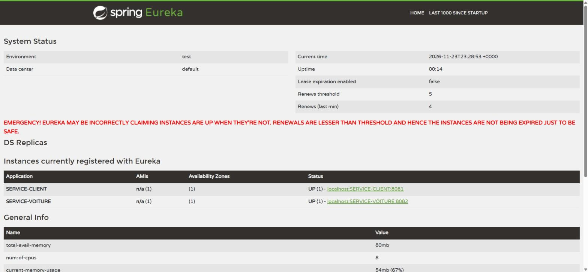
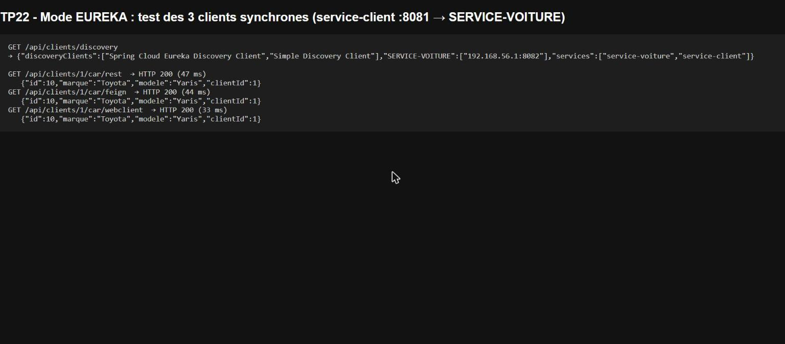
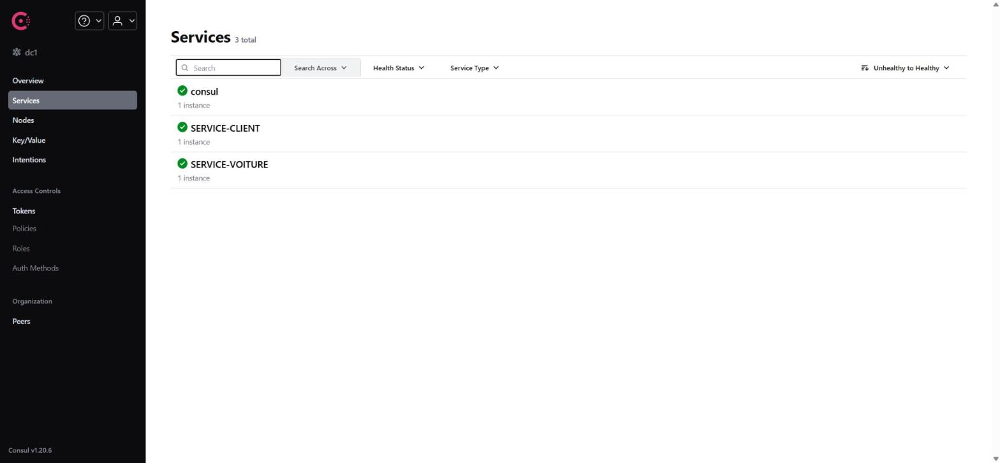
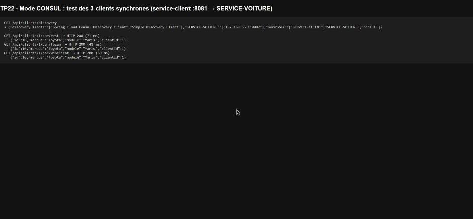
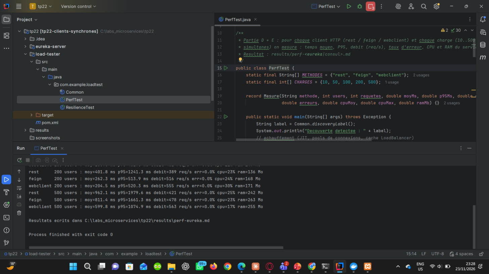
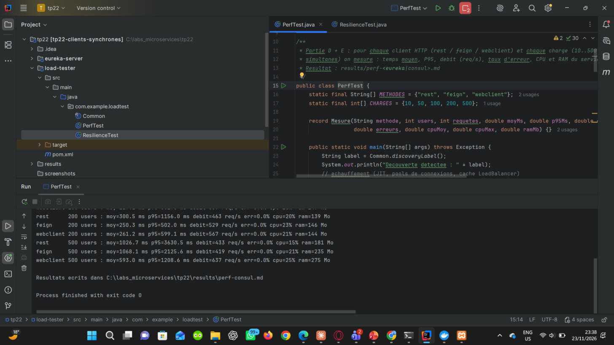
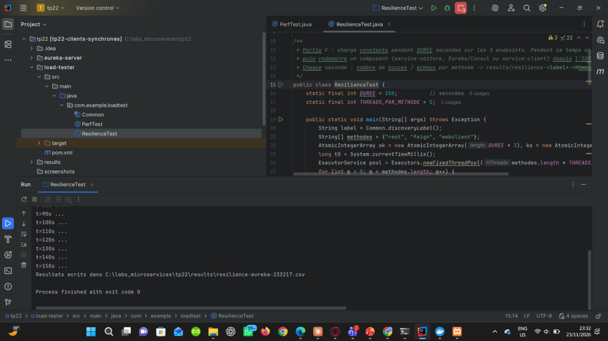
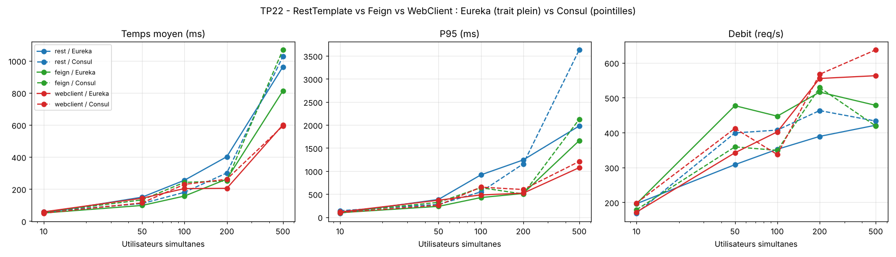
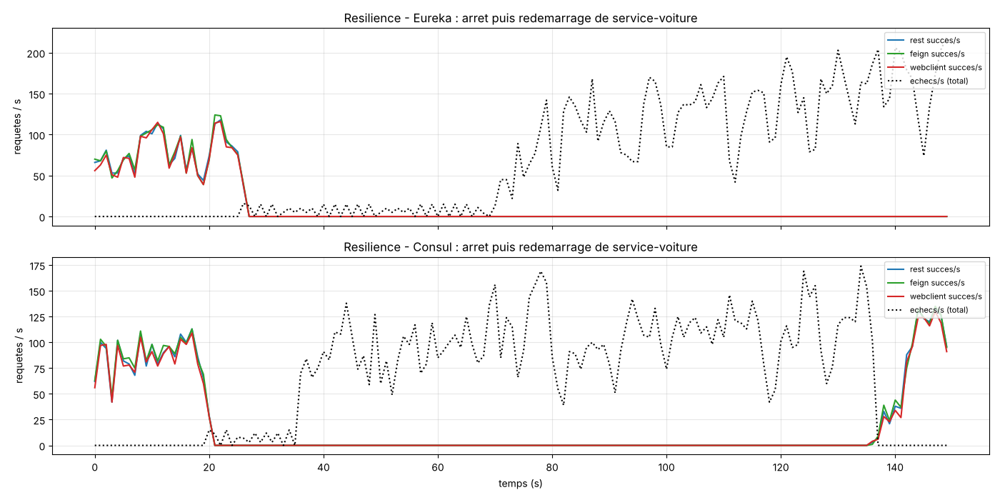

# TP 22 : Clients synchrones — RestTemplate vs Feign vs WebClient, avec Eureka puis Consul

Module **Architecture Microservices : conception, déploiement et orchestration**.
Lab : « Étude de cas : clients synchrones (RestTemplate vs Feign vs WebClient) avec Eureka et Consul ».

L'objectif est de **comparer trois façons d'appeler un microservice en HTTP synchrone** :

1. `RestTemplate` ;
2. `OpenFeign` ;
3. `WebClient` utilisé en mode bloquant avec `block()`.

La comparaison se fait **avec deux annuaires de services différents** : Eureka, puis Consul.

Pour chaque combinaison, on mesure :

- le temps de réponse (moyenne et P95) ;
- le débit ;
- le taux d'erreurs ;
- la consommation CPU et RAM ;
- le **comportement en cas de panne** (résilience).

---

## 1. Architecture

```
                         +-------------------------+
                         |  Annuaire de services   |
                         |  Eureka :8761           |
                         |    ou Consul :8500      |
                         +-----------+-------------+
                     enregistrement  |  découverte (nom logique)
             +-----------------------+------------------------+
             |                                                |
 +-----------v------------+     HTTP synchrone    +-----------v-----------+
 | service-client  :8081  | --------------------> | service-voiture :8082 |
 |  /car/rest     (RestTemplate @LoadBalanced)   | GET /api/cars/byClient|
 |  /car/feign    (@FeignClient)                 |   /{clientId}         |
 |  /car/webclient(WebClient @LoadBalanced+block)|  (délai simulé 20 ms) |
 +-----------^------------+                       +-----------------------+
             |
 +-----------+------------+
 | load-tester (Java pur) |  PerfTest : charges 10 → 500 utilisateurs
 |                        |  ResilienceTest : charge constante 150 s + panne
 +------------------------+
```

| Module | Port | Rôle |
|---|---|---|
| `eureka-server` | 8761 | Annuaire Eureka (`@EnableEurekaServer`) |
| Consul (Docker, `docker-compose.yml`) | 8500 | Annuaire Consul (`hashicorp/consul:1.20`, `agent -dev -ui`) |
| `service-voiture` | 8082 | Fournisseur : renvoie la voiture d'un client (JSON < 1 Ko, `Thread.sleep(20)`) |
| `service-client` | 8081 | Consommateur : expose **3 endpoints**, un par client HTTP, plus `/discovery` pour le diagnostic |
| `load-tester` | — | Programmes de mesure (`PerfTest`, `ResilienceTest`), résultats dans `results/` |

**Technologies** : Java 17, Spring Boot 3.2.0, Spring Cloud 2023.0.0 (Netflix Eureka, Consul Discovery, OpenFeign, LoadBalancer), WebFlux (WebClient), Actuator, Docker.

---

## 2. Structure du projet

```
tp22/
├── pom.xml                      (agrégateur Maven)
├── docker-compose.yml           (Consul en mode dev)
├── eureka-server/
├── service-voiture/
│   └── src/main/resources/application.yml, application-eureka.yml, application-consul.yml
├── service-client/
│   ├── config/HttpClientsConfig.java    (RestTemplate + WebClient.Builder @LoadBalanced)
│   ├── feign/VoitureFeignClient.java    (@FeignClient(name = "SERVICE-VOITURE"))
│   ├── model/Car.java                   (record DTO)
│   └── web/ClientController.java        (3 endpoints + /discovery)
├── load-tester/                 (Common, PerfTest, ResilienceTest)
├── results/                     (perf-eureka.md, perf-consul.md, resilience-*.csv)
└── screenshots/
```

---

## 3. Étapes réalisées

### Étape A : le service fournisseur (`service-voiture`)

Le service voiture est volontairement minimal. On n'utilise pas de base de données, pour que le temps mesuré soit celui des clients HTTP et pas celui de la BD.

```java
@GetMapping("/byClient/{clientId}")
public Car byClient(@PathVariable Long clientId) throws InterruptedException {
    Thread.sleep(delayMs);           // voiture.delay-ms = 20 : traitement simulé
    return new Car(10L, "Toyota", "Yaris", clientId);
}
```

### Étape B : les trois clients dans `service-client`

**B1, RestTemplate.** C'est un client synchrone classique. L'annotation `@LoadBalanced` permet d'utiliser le nom logique `http://SERVICE-VOITURE/...`.

```java
@Bean @LoadBalanced
public RestTemplate restTemplate() { return new RestTemplate(); }
...
restTemplate.getForObject("http://SERVICE-VOITURE/api/cars/byClient/" + id, Car.class);
```

**B2, OpenFeign.** C'est un client **déclaratif**. On écrit seulement une interface, et Spring génère l'implémentation. Il faut activer Feign avec `@EnableFeignClients` sur la classe principale.

```java
@FeignClient(name = "SERVICE-VOITURE")
public interface VoitureFeignClient {
    @GetMapping("/api/cars/byClient/{clientId}")
    Car byClient(@PathVariable("clientId") Long clientId);
}
```

Les timeouts sont configurés dans `spring.cloud.openfeign.client.config.default` : `connect-timeout` et `read-timeout` valent 5000 ms.

**B3, WebClient.** C'est le client réactif de WebFlux. On l'utilise ici avec `block()` pour le comparer aux deux autres dans les mêmes conditions.

```java
@Bean @LoadBalanced
public WebClient.Builder webClientBuilder() { return WebClient.builder(); }
...
webClient.get().uri(URL + id).retrieve().bodyToMono(Car.class).block();
```

Les endpoints exposés sont les suivants :

| Endpoint | Client utilisé |
|---|---|
| `GET /api/clients/{id}/car/rest` | RestTemplate |
| `GET /api/clients/{id}/car/feign` | OpenFeign |
| `GET /api/clients/{id}/car/webclient` | WebClient + `block()` |
| `GET /api/clients/discovery` | Indique le DiscoveryClient actif et les instances de SERVICE-VOITURE |

`server.tomcat.threads.max` est fixé à 400, pour que le service supporte les charges de 200 à 500 utilisateurs.

### Étape C1 : mode Eureka

1. On démarre `EurekaServerApplication` (port 8761), puis `ServiceVoitureApplication` et `ServiceClientApplication`, depuis la fenêtre **Services** d'IntelliJ.
2. Le profil actif est `spring.profiles.active: eureka`. Le fichier `application-eureka.yml` désactive Consul avec `spring.cloud.consul.enabled: false`.
3. On vérifie que les deux services sont **UP** dans le tableau de bord Eureka :



4. On vérifie ensuite les trois clients. `/discovery` affiche `Spring Cloud Eureka Discovery Client` :



### Étape C2 : migration vers Consul

1. On lance Consul avec Docker, en exécutant `docker compose up -d` (fichier `docker-compose.yml`). L'interface est disponible sur http://localhost:8500.
2. Dans les deux fichiers `application.yml`, on remplace `spring.profiles.active: eureka` par `consul`. Le fichier `application-consul.yml` :
   - désactive Eureka avec `eureka.client.enabled: false` ;
   - configure `spring.cloud.consul.host/port` ;
   - définit `prefer-ip-address` et un `instance-id` unique ;
   - ajoute un **health check** Actuator sur `/actuator/health` toutes les 10 s.
3. On arrête `eureka-server` et on redémarre les deux services.
4. **Aucune ligne de code Java ne change.** Le nom logique `SERVICE-VOITURE` est maintenant résolu par Consul, et `/discovery` affiche `Spring Cloud Consul Discovery Client`.





### Étapes D et E : tests de performance (`PerfTest`)

Pour chaque charge (10, 50, 100, 200 et 500 utilisateurs simultanés) et pour chaque client :

- on lance au moins 1000 requêtes sur `/api/clients/1/car/{methode}` ;
- on commence par un échauffement (JIT, pools de connexions, cache du LoadBalancer) ;
- on mesure la **moyenne**, le **P95**, le **débit** et les **erreurs** ;
- on mesure le **CPU et la RAM** de service-client, en interrogeant `/actuator/metrics` toutes les 250 ms.

On lance le test avec le ▶ de la gouttière de `PerfTest.main()` dans IntelliJ. Le programme détecte seul le mode Eureka ou Consul grâce à `/discovery`, puis écrit `results/perf-<mode>.md`.




### Étape F : résilience (`ResilienceTest`)

Le test envoie une charge constante pendant **150 s**, avec 5 threads pour chaque client. Pendant le test :

1. on **arrête service-voiture** depuis la fenêtre Services d'IntelliJ ;
2. on le **redémarre** environ 40 s plus tard.

Le CSV enregistre, seconde par seconde, le nombre de succès et d'échecs pour chaque client.




---

## 4. Résultats

Conditions de mesure : PC Windows avec 8 cœurs, et tous les services sur la même machine. service-voiture a un délai simulé de 20 ms, et l'on obtient **0 % d'erreurs dans toutes les mesures**.

### 4.1 Performance en mode Eureka (`results/perf-eureka.md`)

| Méthode | Utilisateurs | Moyenne (ms) | P95 (ms) | Débit (req/s) | CPU moy. | RAM (Mo) |
|---|---|---|---|---|---|---|
| rest | 10 | 50.7 | 86.7 | 196 | – | 145 |
| feign | 10 | 50.7 | 96.0 | 196 | 15 % | 143 |
| webclient | 10 | 57.8 | 113.5 | 172 | 14 % | 143 |
| rest | 50 | 149.5 | 384.4 | 308 | 16 % | 146 |
| feign | 50 | **97.8** | **233.8** | **477** | 21 % | 148 |
| webclient | 50 | 142.9 | 367.5 | 342 | 20 % | 139 |
| rest | 100 | 255.0 | 917.4 | 352 | 17 % | 162 |
| feign | 100 | **156.4** | **424.7** | **447** | 23 % | 133 |
| webclient | 100 | 203.0 | 481.8 | 402 | 22 % | 147 |
| rest | 200 | 401.8 | 1241.3 | 389 | 23 % | 136 |
| feign | 200 | 262.3 | **513.9** | 516 | 24 % | 168 |
| webclient | 200 | **204.5** | 520.3 | **555** | 30 % | 171 |
| rest | 500 | 962.1 | 1979.6 | 421 | 25 % | 242 |
| feign | 500 | 811.4 | 1661.3 | 478 | 23 % | 263 |
| webclient | 500 | **599.8** | **1074.9** | **563** | 17 % | 255 |

### 4.2 Performance en mode Consul (`results/perf-consul.md`)

| Méthode | Utilisateurs | Moyenne (ms) | P95 (ms) | Débit (req/s) | CPU moy. | RAM (Mo) |
|---|---|---|---|---|---|---|
| rest | 10 | 58.6 | 139.9 | 169 | 15 % | 137 |
| feign | 10 | 55.4 | 104.0 | 179 | 12 % | 143 |
| webclient | 10 | **49.8** | **98.5** | **198** | 17 % | 145 |
| rest | 50 | **109.6** | 276.4 | 399 | 19 % | 149 |
| feign | 50 | 132.5 | 321.7 | 359 | 20 % | 144 |
| webclient | 50 | 113.7 | **259.0** | **412** | 23 % | 140 |
| rest | 100 | **179.8** | **547.4** | **407** | 19 % | 143 |
| feign | 100 | 241.8 | 639.1 | 349 | 22 % | 143 |
| webclient | 100 | 229.2 | 651.0 | 337 | 16 % | 147 |
| rest | 200 | 300.5 | 1156.0 | 463 | 20 % | 139 |
| feign | 200 | **250.3** | **502.0** | 529 | 23 % | 146 |
| webclient | 200 | 261.2 | 599.1 | **567** | 21 % | 144 |
| rest | 500 | 1026.7 | 3630.5 | 433 | 15 % | 181 |
| feign | 500 | 1068.1 | 2125.6 | 419 | 21 % | 235 |
| webclient | 500 | **593.0** | **1208.6** | **637** | 25 % | 275 |



### 4.3 Résilience : arrêt puis redémarrage de service-voiture



| Phase | Eureka | Consul |
|---|---|---|
| Avant la panne | Environ 80 à 100 succès/s pour chaque client, 0 erreur | Même comportement |
| Juste après l'arrêt | Erreurs **lentes** (connexion refusée sur l'ancienne adresse encore présente dans le cache) | Même comportement |
| Bascule vers des erreurs **rapides** (« aucune instance disponible ») | Environ **45 s** après l'arrêt (caches Eureka client + serveur + LoadBalancer) | Environ **13 s** après l'arrêt (désinscription immédiate + health check) |
| Retour des succès après le redémarrage | **Plus de 80 s** : pas de retour avant la fin du test, retour constaté juste après | Environ **10 à 15 s** après la fin du démarrage |
| Comportement des 3 clients | Identique : ils dépendent du même DiscoveryClient et du même LoadBalancer | Identique |

---

## 5. Analyse

- **À faible charge (10 utilisateurs)**, les trois clients se valent, autour de 50 à 58 ms. Le temps est dominé par le délai de 20 ms et la latence réseau locale.
- **À forte charge (500 utilisateurs)**, WebClient obtient le meilleur résultat dans les deux modes :
  - temps moyen d'environ 600 ms, contre 800 à 1070 ms pour les deux autres ;
  - P95 environ 2 fois plus faible ;
  - débit le plus élevé (563 et 637 req/s).

  Cela s'explique par son client HTTP Reactor Netty, non bloquant, avec un pool de connexions efficace, même si l'on appelle `block()` côté Tomcat.
- **RestTemplate** (`SimpleClientHttpRequestFactory`, sans pool de connexions) se dégrade le plus vite. On le voit surtout sur le P95 : jusqu'à 3,6 s en mode Consul à 500 utilisateurs.
- **Feign** se situe entre les deux. Il a été le plus rapide entre 50 et 100 utilisateurs en mode Eureka. Son intérêt principal est la **lisibilité** du code : une simple interface.
- **Eureka comparé à Consul :** la différence de performance « à chaud » est faible, parce que les instances sont mises en cache par le LoadBalancer. Les écarts mesurés relèvent surtout de la variance d'un PC partagé.
- **La vraie différence est la réactivité aux pannes.** Consul détecte et propage beaucoup plus vite :
  - la disparition d'une instance (désinscription immédiate et health check) ;
  - son retour.

  Eureka repose sur plusieurs caches de 30 s : le registre du client, le cache de réponses du serveur, et le cache de 35 s du LoadBalancer. Il peut donc mettre plus d'une minute à voir une instance revenue.
- **CPU et RAM :** l'empreinte est similaire, entre 15 et 30 % de CPU et entre 135 et 275 Mo de RAM pour service-client. La RAM augmente avec la charge à cause des threads Tomcat et des buffers.

**Conclusion :**

| Besoin | Choix conseillé |
|---|---|
| Code simple et lisible pour des appels inter-services | Feign |
| Forte concurrence | WebClient, de préférence en vraie chaîne réactive sans `block()` |
| Code ancien | RestTemplate, qui reste fonctionnel mais est en mode maintenance |
| Détection rapide des pannes, health checks, clé/valeur | Consul plutôt qu'Eureka |

---

## 6. Problèmes rencontrés et solutions

| Problème | Cause | Solution |
|---|---|---|
| Juste après le démarrage, `/discovery` renvoie `"SERVICE-VOITURE": []` et les endpoints renvoient 500 | Propagation du registre Eureka (caches de 30 s) | Attendre environ 30 à 60 s avant de lancer les tests |
| `CPU = NaN` sur le tout premier échantillon | `process.cpu.usage` n'est pas encore calculé par la JVM | Les valeurs NaN sont ignorées dans la moyenne |
| Eureka et Consul actifs en même temps : `CompositeDiscoveryClient` ambigu | Les deux starters sont dans le classpath | Un profil par annuaire, chacun désactivant l'autre (`eureka.client.enabled=false` ou `spring.cloud.consul.enabled=false`) |
| Le redémarrage d'un service depuis IntelliJ prend du temps pendant un test | IntelliJ recompile le projet (« Build before launch ») | En tenir compte dans l'analyse du test de résilience |

---

## 7. Lancer le projet

```bash
# Mode Eureka (profil par défaut "eureka")
#   1) EurekaServerApplication  2) ServiceVoitureApplication  3) ServiceClientApplication
# Mode Consul
docker compose up -d                       # Consul sur :8500
#   mettre spring.profiles.active: consul dans service-client et service-voiture, puis relancer les 2 services
# Mesures
#   load-tester : PerfTest.main()  puis  ResilienceTest.main() (arrêter/redémarrer service-voiture pendant le test)
curl http://localhost:8081/api/clients/1/car/rest
curl http://localhost:8081/api/clients/1/car/feign
curl http://localhost:8081/api/clients/1/car/webclient
curl http://localhost:8081/api/clients/discovery
```

> Le fichier `application.yml` fourni est actuellement en profil **consul**, l'état final du TP.

---

## 8. Résumé de révision pour le QCM

- **RestTemplate** :
  - client HTTP **synchrone et bloquant** de Spring MVC, aujourd'hui en *mode maintenance* ;
  - `@LoadBalanced` permet d'appeler `http://NOM-LOGIQUE/...` ;
  - méthodes : `getForObject`, `getForEntity`, `postForObject`, `exchange`.
- **OpenFeign** :
  - client **déclaratif**, sous forme d'une interface ;
  - activé par `@EnableFeignClients`, avec `@FeignClient(name="SERVICE-X")` et des annotations Spring MVC (`@GetMapping`, `@PathVariable("id")`, nom obligatoire) ;
  - intègre le LoadBalancer automatiquement ;
  - les timeouts se règlent dans `spring.cloud.openfeign.client.config.default.*`.
- **WebClient** :
  - client **non bloquant et réactif** de WebFlux, avec Reactor Netty ;
  - `retrieve().bodyToMono(T.class)` renvoie un `Mono<T>`, et `bodyToFlux` un `Flux<T>` ;
  - `block()` le rend synchrone ;
  - le bean `WebClient.Builder` doit porter `@LoadBalanced`.
- **Spring Cloud LoadBalancer** a remplacé Ribbon. Il choisit une instance (round-robin par défaut) à partir du `DiscoveryClient`, et garde un **cache de 35 s par défaut**.
- **Eureka** (Netflix) :
  - modèle AP ;
  - le client envoie un *heartbeat* toutes les 30 s et récupère le registre toutes les 30 s ;
  - mode auto-préservation (message « EMERGENCY! ... ») ;
  - serveur : `@EnableEurekaServer` sur le port 8761 ;
  - client : `eureka.client.service-url.defaultZone`.
- **Consul** (HashiCorp) :
  - modèle CP (Raft), avec agent, UI sur le port **8500**, DNS sur le port 8600, magasin **clé/valeur** et **health checks actifs** ;
  - starter : `spring-cloud-starter-consul-discovery` ;
  - propriétés : `spring.cloud.consul.host/port` et `discovery.health-check-path=/actuator/health`.
- **Migration d'Eureka vers Consul** : on change la dépendance et la configuration YAML. **Le code reste le même** grâce à l'abstraction `DiscoveryClient` et à `@EnableDiscoveryClient`.
- **Métriques de performance** :
  - temps moyen ;
  - **P95**, le temps sous lequel se trouvent 95 % des requêtes, plus représentatif que la moyenne ;
  - débit en req/s ;
  - taux d'erreur ;
  - CPU et RAM, via `/actuator/metrics/process.cpu.usage` et `jvm.memory.used`.
- **Résultats à retenir :**
  - à faible charge, les trois clients sont équivalents ;
  - à forte charge, **WebClient** offre le meilleur débit et le meilleur P95, et RestTemplate se dégrade le plus ;
  - Consul détecte et rétablit une instance **beaucoup plus vite** qu'Eureka (environ 10 s contre plus d'une minute).
